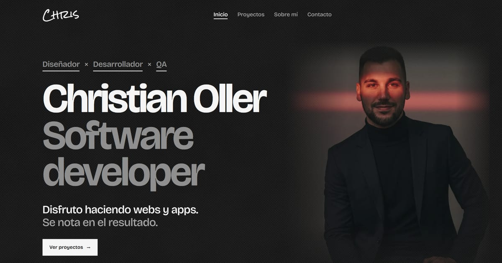
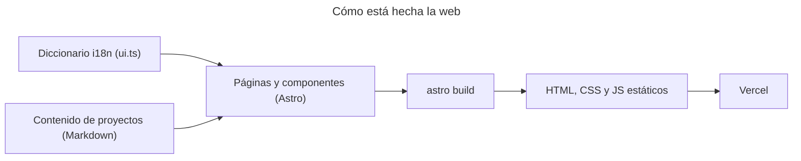

<a name="readme-top"></a>

<div align="center">

[English](./README.md) · **Español**

# Christian Oller, portfolio

Portfolio bilingüe de un software developer que diseña, programa y prueba. Cada página es un frame de una herramienta de diseño que se puede tocar.

**[Web en vivo](https://www.christianoller.dev)** · [Arquitectura](#arquitectura) · [Puesta en marcha](#puesta-en-marcha) · [Dónde están las decisiones de diseño](#dónde-están-las-decisiones-de-diseño)

<a href="https://www.christianoller.dev">
  
</a>

</div>

## Sobre el proyecto

Un portfolio suele contar lo que sabe hacer su autor. Este deja que el visitante lo compruebe: la misma página se puede leer como diseño, como código o como informe de pruebas, y los proyectos se pueden probar en vez de describirse.

### Funcionalidades principales

- **Tres lentes**: diseñador, desarrollador y QA. Cada una redibuja la página como lo haría su herramienta (cuadros de selección y medidas, etiquetas de los elementos, comprobaciones que pasan o fallan).
- **Lienzo navegable**: todas las páginas colocadas como frames en un artboard, con los hilos de prototipo entre ellas. Se abre desde el bocadillo de la caricatura de la esquina o con la tecla `M`.
- **Cambios de página como movimientos de cámara**: las páginas panean como frames sobre un lienzo y un personaje empuja la anterior. Con "reducir movimiento" todo se para.
- **Proyectos que se pueden probar**: pequeñas demos interactivas de Tempora, Vibora y Learnish, y la web real de Vístalo dentro de su marco.
- **Capas en 3D**: boceto, diseño, código y pruebas de una página de ejemplo, separadas con three.js. Se giran arrastrando o con las flechas. Sin WebGL se ven planas.
- **Dos idiomas**: español en la raíz e inglés bajo `/en/`, con las mismas claves en los dos diccionarios.
- **Temas claro y oscuro**, que se recuerdan entre visitas.

### Alcance y no-objetivos

| Estado | Capacidad | Nota |
| --- | --- | --- |
| Hecho | Web estática en español e inglés | Prerenderizada con Astro, sin servidor |
| Hecho | Formulario de contacto sin backend | Abre el cliente de correo del visitante con el mensaje escrito; con `PUBLIC_FORM_ENDPOINT` definida lo envía allí |
| Pendiente | Capturas reales de Tempora, Vibora y Learnish | Sus interfaces son fragmentos de HTML hechos para la web |
| Fuera de alcance | CMS, cuentas, analítica, cookies | La web no carga scripts de terceros por sí misma; lo único ajeno es la web real de Vístalo, que se incrusta en un iframe solo cuando el visitante pulsa para abrir esa demo |

## Arquitectura



Los textos viven en un diccionario y los proyectos en Markdown; Astro convierte los dos en páginas estáticas que sirve Vercel. El navegador recibe HTML plano y los scripts de `src/scripts/` añaden encima las lentes, el lienzo, las demos y las transiciones de página.

### Decisiones técnicas

| Decisión | Alternativa descartada | Por qué, y qué cuesta |
| --- | --- | --- |
| Todo texto visible en `src/i18n/ui.ts`, con las mismas claves en `es` y `en`; un componente de página compartido por página y un archivo de ruta de cinco líneas por idioma que solo elige el idioma | Páginas duplicadas por idioma | Una sola copia del diseño y sin diferencias entre idiomas; cada texto nuevo necesita sus dos versiones |
| `ClientRouter` de Astro para cambiar de página sin recargar, que hace posible el paneo entre páginas | Cargas de página completas | Transiciones fluidas y una barra que no se repinta; cada script tiene que volver a enlazarse en `astro:page-load` y limpiar antes del cambio |
| three.js se carga solo cuando la sección de capas se acerca a la pantalla | Incluirlo con la página de inicio | La primera carga se queda ligera; la sección enseña su versión plana hasta que llega la librería |
| Superficies y colores como tokens en `src/styles/global.css` (`--sheet`, `--paper`, `--ink`), cada uno con su valor oscuro | Colores sueltos en cada componente | Un único sitio para cambiar un color y los dos temas siempre a la par; los componentes no pueden inventar un tono |

<details>
<summary><strong>Estructura del proyecto</strong></summary>

| Ruta | Responsabilidad |
| --- | --- |
| `src/pages/` y `src/components/pages/` | Rutas (español en la raíz, inglés bajo `/en/`) y los componentes de página que comparten |
| `src/components/home/` | Hero, tarjetas de proyecto que se tocan, escena de scroll y capas 3D |
| `src/components/site/`, `src/components/common/` | Barra, lentes, lienzo, intro y pie |
| `src/components/character/`, `src/scripts/character.ts` | El personaje articulado que mueve las páginas |
| `src/scripts/` | Comportamiento: lentes, lienzo, transiciones de página, demos, capas 3D |
| `src/styles/` | `global.css` (tokens y base), `kit.css` (piezas de herramienta) y `lenses.css` |
| `src/i18n/ui.ts` | Todos los textos, en español e inglés |
| `src/data/`, `src/content/projects/` | Trayectoria, contenido de los casos y los cuatro proyectos |
| `docs/referencias/` | Plan de diseño, decisiones, auditoría y notas de estado (en español) |

</details>

## Stack tecnológico

| Capa | Tecnología | Para qué |
| --- | --- | --- |
| Framework | Astro 5 | Páginas estáticas, rutas i18n, colecciones de contenido, transiciones de vista |
| Estilos | Tailwind CSS 4 y CSS propio | Tokens, maquetación y las piezas de herramienta |
| Lenguaje | TypeScript | Scripts y datos |
| 3D | three.js 0.170 | La vista en capas |
| Fuentes | Bricolage Grotesque e IBM Plex Mono | Texto y código, servidas desde la propia web |
| Alojamiento | Vercel | Hosting estático, con las cabeceras en `vercel.json` |

## Puesta en marcha

### Requisitos previos

- Node.js 22
- pnpm

### Ejecútalo

```bash
git clone https://github.com/christianoller8/astro-portfolio.git
cd astro-portfolio
pnpm install
pnpm dev
```

Abre <http://localhost:4321>.

Para ver la versión de producción:

```bash
pnpm build
pnpm preview --port 4400
```

`pnpm preview` sirve `dist/`, así que vuelve a ejecutar `pnpm build` después de cambiar código.

### Variables de entorno

| Variable | Obligatoria | Por defecto | Descripción |
| --- | :---: | --- | --- |
| `PUBLIC_FORM_ENDPOINT` | No | vacía | Endpoint que recibe el formulario de contacto. Vacía: el formulario abre el cliente de correo del visitante |

## Pruebas y verificación

```bash
pnpm astro check
```

`pnpm astro check` revisa los tipos de TypeScript y las plantillas de Astro y tiene que dar 0 errores. Antes de publicar, construye la web y mírala con `pnpm preview` en un navegador real.

La suite de Playwright de `tests/` sigue apuntando a una versión anterior de la web, así que su workflow solo se ejecuta a mano hasta que se reescriba.

## Estado y hoja de ruta

**Estado:** activo. Los próximos pasos y las decisiones abiertas están en `docs/referencias/estado-actual.md` y `docs/referencias/roadmap-prototipo-def.md`.

## Dónde están las decisiones de diseño

El diseño está escrito, en español, en `docs/referencias/`:

- [`estado-actual.md`](./docs/referencias/estado-actual.md): dónde está el trabajo hoy.
- [`plan-diseno-awwwards.md`](./docs/referencias/plan-diseno-awwwards.md): el plan de diseño y sus decisiones numeradas.
- [`roadmap-prototipo-def.md`](./docs/referencias/roadmap-prototipo-def.md): el orden de trabajo y lo que está hecho.
- [`auditoria-2026-11-20.md`](./docs/referencias/auditoria-2026-11-20.md): la auditoría de la web publicada y lo que se arregló.

## Autoría

Diseñado, programado y probado por **Christian Oller**.

[Web](https://www.christianoller.dev) · [GitHub](https://github.com/christianoller8) · [LinkedIn](https://www.linkedin.com/in/christian-oller)

<p align="right"><a href="#readme-top">Volver arriba</a></p>
