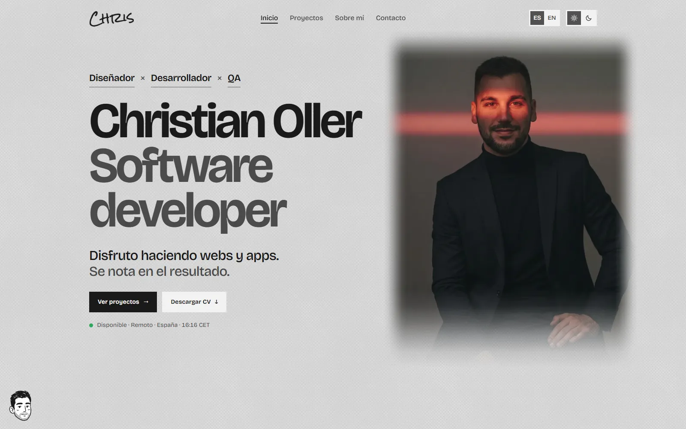
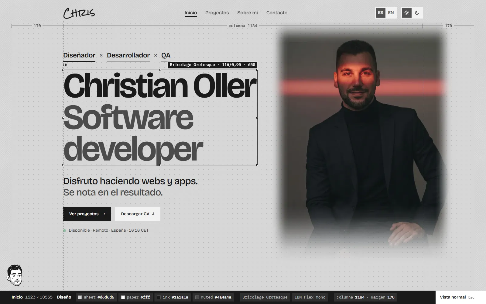
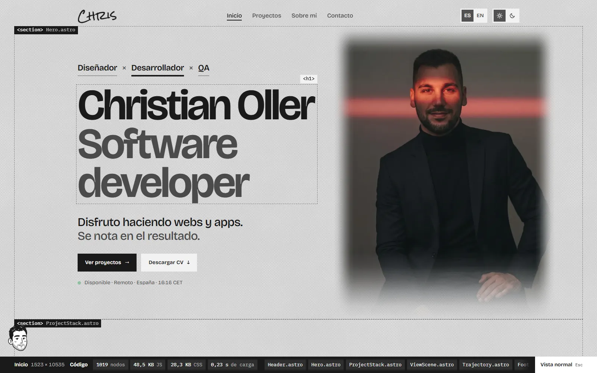
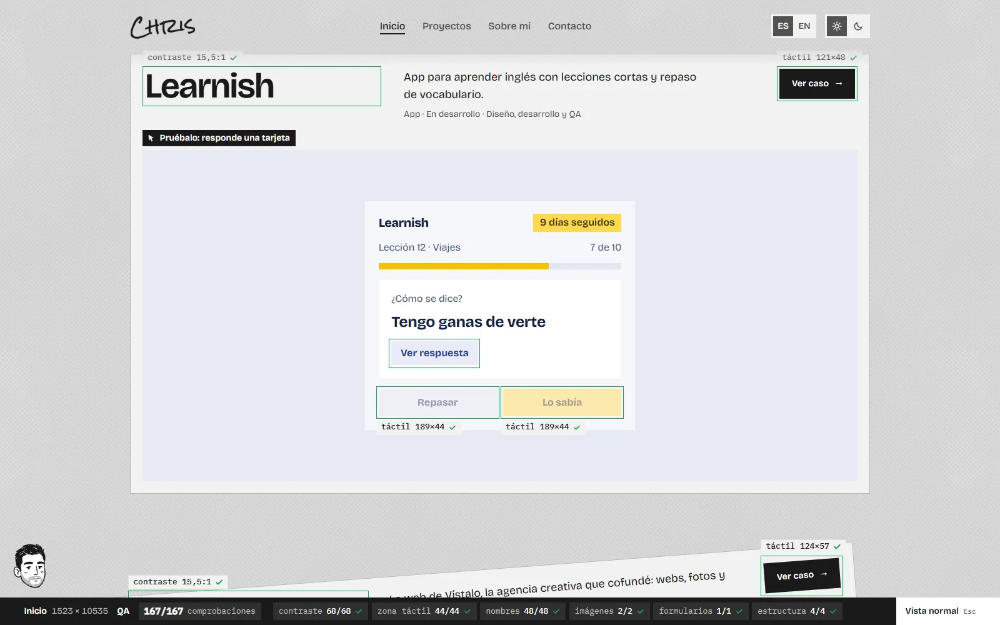
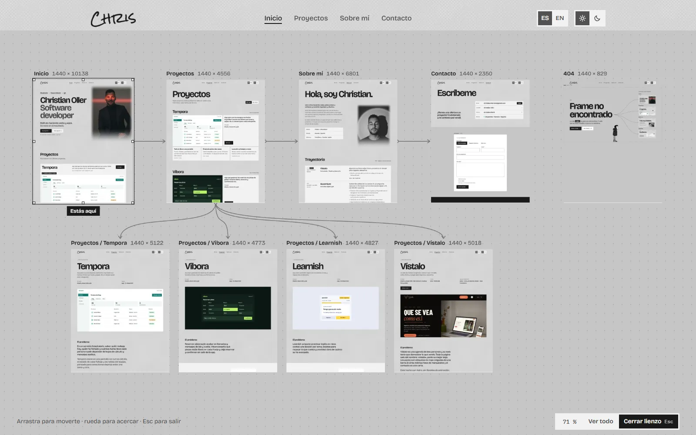
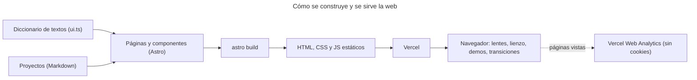

<a name="readme-top"></a>

<div align="center">

[English](./README.md) · **Español**

# Christian Oller, portfolio

Portfolio bilingüe de un diseñador, desarrollador y QA: cada página se puede leer como diseño, como código o como informe de pruebas.

[](https://github.com/christianoller8/astro-portfolio/actions/workflows/playwright.yml)
[](https://www.christianoller.dev)
[](https://github.com/christianoller8/astro-portfolio/commits/main)

**[Web en vivo](https://www.christianoller.dev)** · [Demo](#demo) · [Arquitectura](#arquitectura) · [Puesta en marcha](#puesta-en-marcha) · [Pruebas](#pruebas-y-verificación)

<picture>
  <source media="(prefers-color-scheme: dark)" srcset="./docs/assets/home-dark-es.webp">
  <source media="(prefers-color-scheme: light)" srcset="./docs/assets/home-light-es.webp">
  
</picture>

</div>

## Demo

<table>
  <tr>
    <td width="50%"></td>
    <td width="50%"></td>
  </tr>
  <tr>
    <td width="50%"></td>
    <td width="50%"></td>
  </tr>
</table>

<!-- Vídeo: cuando exista la demo de 20–40 s, pega aquí su URL de user-attachments, sola en esta línea -->

## Sobre el proyecto

Un portfolio suele contar lo que sabe hacer su autor. Este deja que un reclutador o un equipo de producto lo compruebe: la misma página se puede leer como diseño, como código o como informe de pruebas, los proyectos se prueban en lugar de describirse y la web entera se ve de un vistazo como un archivo de diseño.

### Funcionalidades principales

- **Tres lentes**: pulsa 1, 2 o 3, o abre el bocadillo de la caricatura. Diseño dibuja guías, medidas y fichas tipográficas; Código etiqueta cada bloque con el archivo de su componente y pesa la página; QA comprueba contraste, zonas táctiles, nombres accesibles, imágenes, formularios y estructura, y cuenta lo que pasa.
- **Lienzo navegable**: pulsa M para ver todas las páginas, la 404 incluida, como frames de un archivo. Pulsa un frame y la cámara entra en él.
- **Proyectos que se prueban**: añade un turno en Tempora, reserva una pista en Vibora, responde una tarjeta en Learnish o abre la web real de Vístalo dentro de su marco.
- **Proyectos apilados**: en escritorio, cada tarjeta se queda fija bajo la barra y la siguiente sube y la tapa.
- **Cambios de página como movimientos de cámara**: las páginas se desplazan como frames de un lienzo mientras un personaje empuja la anterior; la tarjeta de un proyecto se transforma en su caso.
- **Capas en 3D**: boceto, diseño, código y pruebas de una página de ejemplo, separados con three.js. Arrástralas o usa las flechas para girarlas.
- **Claro y oscuro**: el tema nuevo se abre desde el sol o se cierra hacia la luna, y se recuerda.
- **Español e inglés**: español en la raíz e inglés bajo `/en/`.

### Alcance y no-objetivos

| Estado | Capacidad | Nota |
| --- | --- | --- |
| Hecho | Web estática en español e inglés | Generada por Astro; sin servidor |
| Hecho | Analítica sin cookies | Vercel Web Analytics; quien visita puede desactivarla en la página de privacidad |
| Hecho | Formulario de contacto sin backend | Abre el programa de correo del visitante; envía a `PUBLIC_FORM_ENDPOINT` cuando está definido |
| Hecho | Pruebas de extremo a extremo | Playwright en escritorio y en móvil, en español e inglés, en cada push |
| Pendiente | Capturas reales de Tempora, Vibora y Learnish | Sus interfaces son fragmentos HTML hechos para la web, con datos ficticios |
| Fuera de alcance | CMS, cuentas, cookies | El contenido vive en Markdown y en un diccionario |

## Arquitectura



Los textos viven en un diccionario y los proyectos en Markdown. Astro convierte ambos en páginas estáticas que sirve Vercel. El navegador recibe HTML sin más, y los scripts de `src/scripts/` añaden encima las lentes, el lienzo, las demos y las transiciones entre páginas; las páginas vistas llegan a Vercel Web Analytics sin cookies.

### Decisiones técnicas

| Decisión | Alternativa descartada | Por qué, y qué cuesta |
| --- | --- | --- |
| Las lentes miden la página viva (cajas, estilos calculados, contraste) cada vez que se abren | Capas preparadas o capturas por página | Siguen siendo ciertas cuando cambia el diseño y funcionan en todas las páginas; el precio es medir y colocar cada etiqueta cada vez que se abre una lente o se desplaza la página |
| Páginas estáticas con el `ClientRouter` de Astro y la API View Transitions | Un framework de aplicación de una sola página | El HTML carga rápido y el desplazamiento entre páginas es posible; cada script tiene que volver a engancharse tras cada cambio de página |
| Tarjetas de proyecto apiladas con CSS `position: sticky` y un guion corto para la inclinación | Una librería de animación ligada al scroll | Sin dependencias, y la pila funciona incluso sin JavaScript; todas las tarjetas deben medir lo mismo, así que en ventanas de menos de 700 px de alto se ve una lista normal |
| Cambio de tema como una sola foto de la página recortada por un círculo que crece | Fundir cada color con transiciones CSS | Un movimiento limpio en lugar de decenas de fundidos; sin la API, con "reducir movimiento" o en iPhone y iPad, el tema cambia como antes |

### Accesibilidad

- **Teclado**: las lentes, el lienzo, el panel y las demos funcionan con teclado; los atajos de una sola tecla se pueden apagar (WCAG 2.1.4) y el foco nunca se queda bajo una tarjeta apilada.
- **Movimiento**: con "reducir movimiento" no hay intro, ni desplazamiento entre páginas, ni círculo de tema; las animaciones en bucle paran a los cinco segundos para todos (WCAG 2.2.2).
- **Lectores de pantalla**: el escenario 3D es un deslizador con su valor hablado; los resultados de las demos, el texto copiado y los errores del formulario se anuncian.
- **Contraste**: los colores del texto son tokens definidos para los dos temas y comprobados a 4,5:1 o más.

### Compatibilidad con navegadores

| Función | Para qué | Sin ella |
| --- | --- | --- |
| API View Transitions | Desplazamiento entre páginas, transformación de proyecto, círculo de tema | Las páginas cambian de golpe; el tema cambia con un fundido de color |
| WebGL | Capas en 3D | Las capas se ven planas |
| Animaciones ligadas al scroll | Tarjetas de proyecto que crecen al entrar en móvil | Las tarjetas aparecen sin crecer |

<details>
<summary><strong>Estructura del proyecto</strong></summary>

| Ruta | Responsabilidad |
| --- | --- |
| `src/pages/`, `src/components/pages/` | Rutas (español en la raíz, inglés bajo `/en/`) y los componentes de página que comparten |
| `src/components/home/` | Hero, tarjetas de proyecto apiladas, escena con scroll y capas 3D |
| `src/components/site/`, `src/components/common/` | Barra, lentes, lienzo, caricatura, intro y pie |
| `src/components/character/` | El personaje articulado que empuja las páginas |
| `src/scripts/` | Comportamiento: lentes, lienzo, transiciones, demos, pila, capas 3D |
| `src/styles/` | `global.css` (tokens y base), `kit.css` (piezas de herramienta), `lenses.css` |
| `src/i18n/ui.ts` | Todos los textos, en español e inglés |
| `src/data/`, `src/content/projects/` | Trayectoria, casos y los cuatro proyectos |
| `docs/referencias/` | Plan de diseño, decisiones, auditoría y notas de estado |
| `docs/assets/` | Capturas de este README |

</details>

## Stack tecnológico

| Capa | Tecnología | Para qué |
| --- | --- | --- |
| Framework |  | Páginas estáticas, rutas por idioma, colecciones de contenido, transiciones |
| Estilos |  | Utilidades de maquetación junto a CSS propio con tokens |
| Lenguaje |  | Scripts y datos |
| 3D |  | Las capas en 3D, que solo se cargan cerca de su sección |
| Alojamiento |  | Hosting estático, cabeceras y analítica sin cookies |

## Puesta en marcha

### Requisitos previos

- Node.js 22 o posterior
- pnpm 10 o posterior

### Arrancarla

```bash
git clone https://github.com/christianoller8/astro-portfolio.git
cd astro-portfolio
pnpm install
pnpm dev
```

Abre <http://localhost:4321>.

Para ver la versión de producción:

```bash
pnpm build
pnpm preview --port 4400
```

`pnpm preview` sirve `dist/`, así que vuelve a ejecutar `pnpm build` tras cambiar código. La analítica solo se carga en Vercel, así que en local no cuenta nada.

### Variables de entorno

Opcionales, en un archivo `.env` en la raíz:

| Variable | Obligatoria | Por defecto | Descripción |
| --- | :---: | --- | --- |
| `PUBLIC_FORM_ENDPOINT` | No | vacía | Endpoint que recibe el formulario de contacto. Vacía: el formulario abre el programa de correo del visitante |

## Pruebas y verificación

```bash
pnpm astro check
pnpm test
```

`pnpm astro check` comprueba los tipos de los scripts y de las plantillas de Astro y debe dar 0 errores.

`pnpm test` lanza la batería de Playwright contra una versión de producción en el puerto 4400 (la construye y la sirve, o aprovecha una vista previa que ya esté abierta ahí). Unas 300 pruebas cubren la navegación, el tema, las lentes, el lienzo, las demos, el formulario de contacto, la privacidad, lo básico de SEO y la accesibilidad de cada página, en escritorio y en móvil y en los dos idiomas. Para la accesibilidad, el juez es la propia lente de QA de la web: todas sus comprobaciones tienen que pasar. La batería usa el Chromium de Playwright si está instalado (`pnpm exec playwright install chromium`) y, si no, Microsoft Edge. GitHub Actions la lanza en cada push.

Para comprobar a mano los dos comportamientos clave en <http://localhost:4400>:

1. **Caso principal**: pulsa 3 en el inicio. La lente de QA marca cada comprobación de la página y la barra de abajo cuenta cuántas pasan.
2. **Caso límite**: en las DevTools de Chrome, abre Rendering y emula `prefers-reduced-motion: reduce`; después recarga. La intro no sale, y el cambio de tema o de página es instantáneo, sin el círculo ni el desplazamiento.

## Despliegue

Vercel construye la rama `main` y la sirve en <https://www.christianoller.dev>. El trabajo se hace en `prototipo-def`, que pasa a `main` cuando se publica una versión. `vercel.json` hace que todas las URL acaben en barra, pone las cabeceras de seguridad y da caché larga a las texturas, a las miniaturas del lienzo y a la imagen para redes.

## Estado y hoja de ruta

**Estado:** activo, publicado y en evolución.

- [ ] Servicio de envío para el formulario de contacto
- [ ] Capturas reales y vídeos cortos de Tempora, Vibora y Learnish
- [ ] Una imagen para redes por página
- [ ] Una política de seguridad de contenidos (CSP) completa

### Dónde están las decisiones de diseño

El diseño está escrito en `docs/referencias/`:

- [`estado-actual.md`](./docs/referencias/estado-actual.md): dónde está el trabajo hoy.
- [`plan-diseno-awwwards.md`](./docs/referencias/plan-diseno-awwwards.md): el plan de diseño y sus decisiones numeradas.
- [`roadmap-prototipo-def.md`](./docs/referencias/roadmap-prototipo-def.md): el orden de trabajo y lo que está hecho.
- [`auditoria-2026-11-20.md`](./docs/referencias/auditoria-2026-11-20.md): la auditoría de la web publicada y lo que se arregló.

## Autoría

Diseñado, programado y probado por **Christian Oller**.

[Web](https://www.christianoller.dev) · [LinkedIn](https://www.linkedin.com/in/christian-oller) · [GitHub](https://github.com/christianoller8) · [Correo](mailto:christianoller.dev@gmail.com)

## Licencia

No se concede ninguna licencia. El código, el diseño y las fotografías son © Christian Oller, todos los derechos reservados.

<p align="right"><a href="#readme-top">Volver arriba</a></p>
