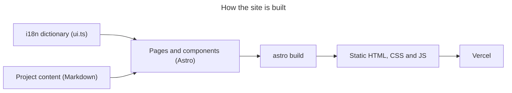

<a name="readme-top"></a>

<div align="center">

**English** · [Español](./README.es.md)

# Christian Oller, portfolio

Bilingual portfolio of a software developer who designs, builds and tests. Every page is a frame in a design tool you can poke at.

**[Live site](https://www.christianoller.dev)** · [Architecture](#architecture) · [Getting started](#getting-started) · [Design decisions](#where-the-design-decisions-live)

<a href="https://www.christianoller.dev">
  
</a>

</div>

## About the project

A portfolio usually says what its author can do. This one lets the visitor check it: the same page can be read as a design, as code or as a test report, and the projects can be tried instead of described.

### Key features

- **Three lenses**: designer, developer and QA. Each one redraws the page as its own tool would (selection boxes and measures, element tags, checks that pass or fail).
- **Navigable canvas**: every page laid out as frames on an artboard, with the prototype threads between them. Open it from the speech bubble of the cartoon in the corner, or with the `M` key.
- **Page changes as camera moves**: pages pan like frames on a canvas, with a character pushing the old one out. With reduced motion, all of it stops.
- **Projects you can try**: small interactive demos of Tempora, Vibora and Learnish, and the live Vístalo site inside its frame.
- **Layers in 3D**: sketch, design, code and tests of a sample page, spread out with three.js. Drag, or use the arrow keys, to turn them. Without WebGL they show flat.
- **Two languages**: Spanish at the root, English under `/en/`, with the same keys in both dictionaries.
- **Light and dark themes**, kept between visits.

### Scope and non-goals

| Status | Capability | Note |
| --- | --- | --- |
| Done | Static site, Spanish and English | Pre-rendered with Astro, no server runtime |
| Done | Contact form without a backend | Opens the visitor's email client with the message written; with `PUBLIC_FORM_ENDPOINT` set it submits there instead |
| Not done | Real screenshots of Tempora, Vibora and Learnish | Their interfaces are HTML fragments built for the site |
| Out of scope | CMS, accounts, analytics, cookies | The site loads no third-party scripts of its own; the only third-party code is the live Vístalo site, embedded in an iframe only when a visitor clicks to open that demo |

## Architecture



The text lives in one dictionary and the projects in Markdown; Astro turns both into static pages that Vercel serves. The browser gets plain HTML, and the scripts in `src/scripts/` add the lenses, the canvas, the demos and the page transitions on top.

### Technical decisions

| Decision | Discarded alternative | Why, and what it costs |
| --- | --- | --- |
| Every user-facing string in `src/i18n/ui.ts`, with the same keys in `es` and `en`; one shared page component per page, and a five-line route file per language that only picks the language | Duplicated pages per language | One copy of the layout and no drift between languages; every new string needs both versions |
| Astro `ClientRouter` for page changes without reload, which makes the pan between pages possible | Full page loads | Smooth transitions and a persistent toolbar; every script has to bind again on `astro:page-load` and clean up before the swap |
| three.js loaded only when the layers section is close to the screen | Bundling it with the home page | The first load stays light; the section shows its flat version until the library arrives |
| Surfaces and colours as tokens in `src/styles/global.css` (`--sheet`, `--paper`, `--ink`), with a dark value for each | Per-component colours | One place to change a colour, and both themes stay in sync; components cannot invent a shade |

<details>
<summary><strong>Project structure</strong></summary>

| Path | Responsibility |
| --- | --- |
| `src/pages/` and `src/components/pages/` | Routes (Spanish at the root, English under `/en/`) and the page components they share |
| `src/components/home/` | Hero, the interactive project cards, the scroll scene and the 3D layers |
| `src/components/site/`, `src/components/common/` | Toolbar, lenses, canvas map, intro and footer |
| `src/components/character/`, `src/scripts/character.ts` | The articulated character that moves the pages |
| `src/scripts/` | Behaviour: lenses, canvas, page transitions, demos, 3D layers |
| `src/styles/` | `global.css` (tokens and base), `kit.css` (tool pieces) and `lenses.css` |
| `src/i18n/ui.ts` | All the text, in Spanish and English |
| `src/data/`, `src/content/projects/` | Career data, case-study content and the four projects |
| `docs/referencias/` | Design plan, decisions, audit and status notes (in Spanish) |

</details>

## Tech stack

| Layer | Technology | Purpose |
| --- | --- | --- |
| Framework | Astro 5 | Static pages, i18n routing, content collections, view transitions |
| Styling | Tailwind CSS 4 and hand-written CSS | Tokens, layout and the tool-like pieces |
| Language | TypeScript | Scripts and data |
| 3D | three.js 0.170 | The layered view |
| Fonts | Bricolage Grotesque and IBM Plex Mono | Text and code, served from the site itself |
| Hosting | Vercel | Static hosting, with headers set in `vercel.json` |

## Getting started

### Prerequisites

- Node.js 22
- pnpm

### Run it

```bash
git clone https://github.com/christianoller8/astro-portfolio.git
cd astro-portfolio
pnpm install
pnpm dev
```

Open <http://localhost:4321>.

To see the production build:

```bash
pnpm build
pnpm preview --port 4400
```

`pnpm preview` serves `dist/`, so run `pnpm build` again after changing code.

### Environment variables

| Variable | Required | Default | Description |
| --- | :---: | --- | --- |
| `PUBLIC_FORM_ENDPOINT` | No | empty | Endpoint that receives the contact form. Empty: the form opens the visitor's email client |

## Testing and verification

```bash
pnpm astro check
```

`pnpm astro check` type-checks the TypeScript and the Astro templates and must report 0 errors. Before publishing, build the site and look at it with `pnpm preview` in a real browser.

The Playwright suite in `tests/` still targets an earlier version of the site, so its workflow only runs by hand until it is rewritten.

## Status and roadmap

**Status:** active. The next steps and the open decisions are in `docs/referencias/estado-actual.md` and `docs/referencias/roadmap-prototipo-def.md`.

## Where the design decisions live

The design is written down, in Spanish, in `docs/referencias/`:

- [`estado-actual.md`](./docs/referencias/estado-actual.md): where the work is today.
- [`plan-diseno-awwwards.md`](./docs/referencias/plan-diseno-awwwards.md): the design plan and its numbered decisions.
- [`roadmap-prototipo-def.md`](./docs/referencias/roadmap-prototipo-def.md): the order of work and what is done.
- [`auditoria-2026-11-20.md`](./docs/referencias/auditoria-2026-11-20.md): the audit of the published site and what was fixed.

## Author

Designed, built and tested by **Christian Oller**.

[Website](https://www.christianoller.dev) · [GitHub](https://github.com/christianoller8) · [LinkedIn](https://www.linkedin.com/in/christian-oller)

<p align="right"><a href="#readme-top">Back to top</a></p>
