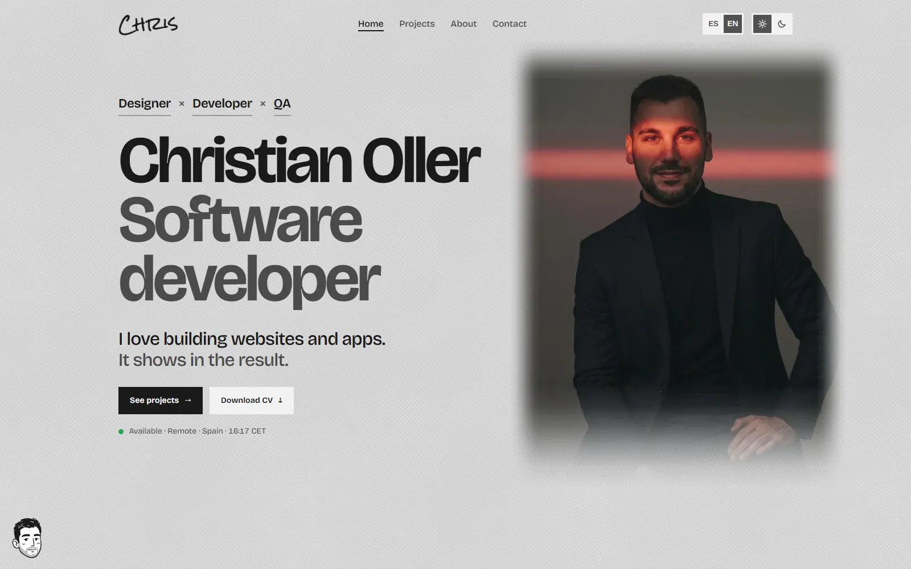
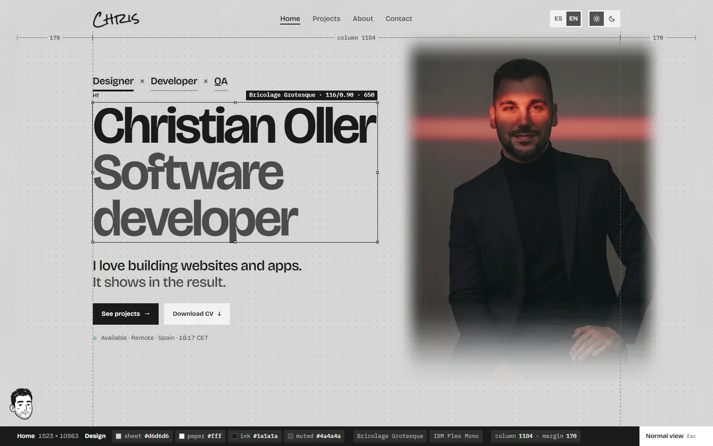
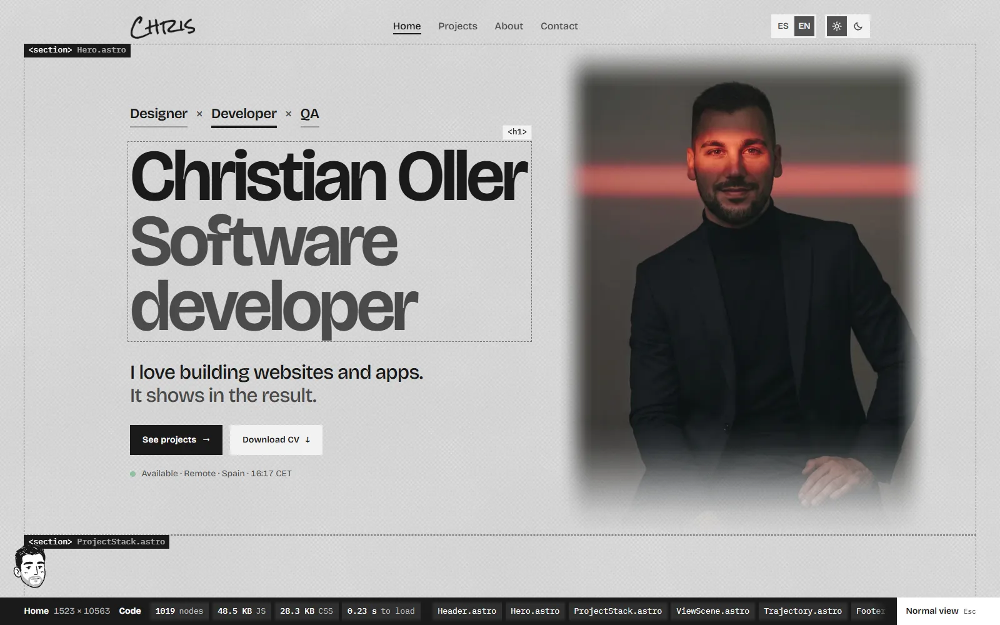
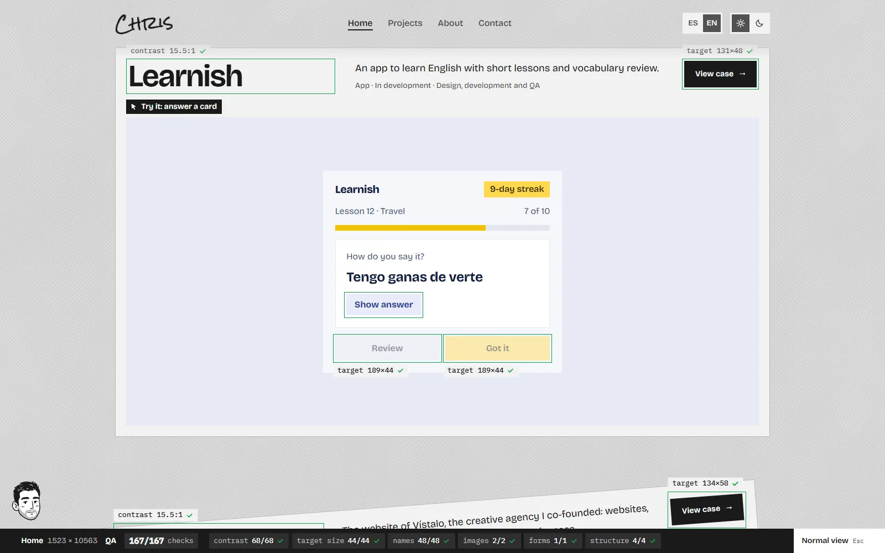
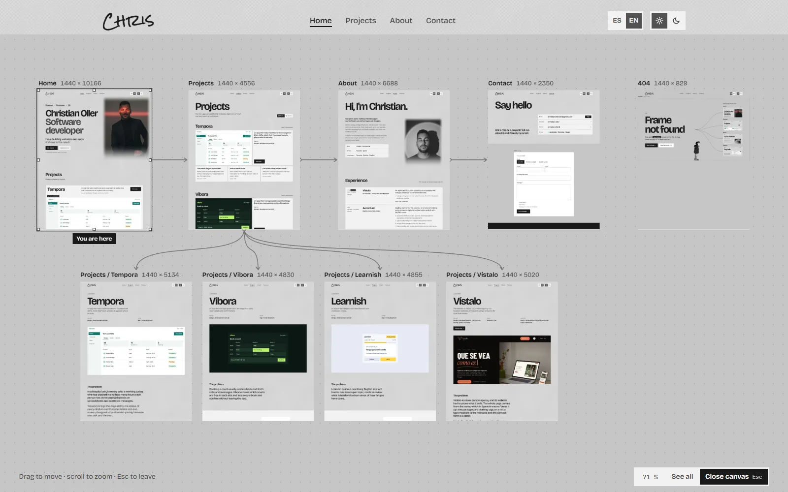
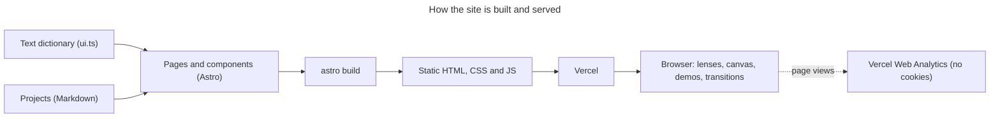

<a name="readme-top"></a>

<div align="center">

**English** · [Español](./README.es.md)

# Christian Oller, portfolio

Bilingual portfolio of a designer, developer and QA: read any page as a design, as code or as a test report.

[](https://github.com/christianoller8/astro-portfolio/actions/workflows/playwright.yml)
[](https://www.christianoller.dev)
[](https://github.com/christianoller8/astro-portfolio/commits/main)

**[Live site](https://www.christianoller.dev/en/)** · [Demo](#demo) · [Architecture](#architecture) · [Getting started](#getting-started) · [Testing](#testing-and-verification)

<picture>
  <source media="(prefers-color-scheme: dark)" srcset="./docs/assets/home-dark-en.webp">
  <source media="(prefers-color-scheme: light)" srcset="./docs/assets/home-light-en.webp">
  
</picture>

</div>

## Demo

<table>
  <tr>
    <td width="50%"></td>
    <td width="50%"></td>
  </tr>
  <tr>
    <td width="50%"></td>
    <td width="50%"></td>
  </tr>
</table>

<!-- Video: when the 20–40 s demo exists, paste its user-attachments URL alone on this line -->

## About the project

A portfolio usually tells what its author can do. This one lets a recruiter or a product team check it: the same page can be read as a design, as code or as a test report, the projects can be tried instead of described, and the whole site can be seen at once as a design file.

### Key features

- **Three lenses**: press 1, 2 or 3, or open the cartoon's speech bubble. Design draws guides, measures and type specs; Code tags every block with its component file and weighs the page; QA checks contrast, touch targets, accessible names, images, forms and structure, and counts what passes.
- **Navigable canvas**: press M to see every page, the 404 included, as frames on an artboard. Click a frame and the camera flies into it.
- **Projects you can try**: add a shift in Tempora, book a court in Vibora, answer a flashcard in Learnish, or open the live Vístalo site inside its frame.
- **Stacked projects**: on desktop each project card sticks under the toolbar and the next one slides over it.
- **Page changes as camera moves**: pages pan like frames on a canvas while a character pushes the old one out; a project card morphs into its case study.
- **Layers in 3D**: sketch, design, code and tests of a sample page, spread out with three.js. Drag or use the arrow keys to turn them.
- **Light and dark**: the new theme opens from the sun button, or closes into the moon, and is remembered.
- **Spanish and English**: Spanish at the root, English under `/en/`.

### Scope and non-goals

| Status | Capability | Note |
| --- | --- | --- |
| Done | Static site in Spanish and English | Pre-rendered by Astro; no server runtime |
| Done | Cookieless analytics | Vercel Web Analytics; visitors can opt out on the privacy page |
| Done | Contact form without a backend | Opens the visitor's email app; posts to `PUBLIC_FORM_ENDPOINT` when it is set |
| Done | End-to-end tests | Playwright on a desktop and a mobile viewport, in Spanish and English, on every push |
| Not done | Real screenshots of Tempora, Vibora and Learnish | Their interfaces are HTML fragments built for the site, with fictional data |
| Out of scope | CMS, accounts, cookies | Content lives in Markdown and in one dictionary |

## Architecture



The text lives in one dictionary and the projects in Markdown. Astro turns both into static pages that Vercel serves. The browser gets plain HTML, and the scripts in `src/scripts/` add the lenses, the canvas, the demos and the page transitions on top; page views go to Vercel Web Analytics without cookies.

### Technical decisions

| Decision | Discarded alternative | Why, and what it costs |
| --- | --- | --- |
| The lenses measure the live page (boxes, computed styles, contrast) every time they open | Prepared overlays or screenshots per page | They stay true when the design changes and work on every page; the price is measuring and placing every label each time a lens opens or the page scrolls |
| Static pages with Astro's `ClientRouter` and the View Transitions API | A single-page app framework | Plain HTML loads fast and the pan between pages is possible; every script has to bind again after each page change |
| Stacked project cards with CSS `position: sticky` and a short script for the tilt | A scroll animation library | No dependency, and the stack works even without JavaScript; all cards must share one height, so below 700 px of window height the site shows a plain list |
| Theme switch as one snapshot of the page clipped by a growing circle | Fading every colour with CSS transitions | One clean movement instead of dozens of colour fades; without the API, with reduced motion or on iPhone and iPad, the theme changes the old way |
| A Content Security Policy that locks every source to the site but allows inline scripts and styles | A hash for every inline script | No maintenance and nothing breaks when content changes; on a static site with no user input there is no way to inject a script, so hashes would add a scanner score more than protection |
| Every page carries its CSS inline (`inlineStylesheets: 'always'`) | Shared stylesheets, cached across pages | On a slow phone the first paint arrives 0.3–1 s sooner (Lighthouse); each page weighs about 21 KB more, and on a slow phone a page change takes up to 0.1 s longer to start |

### Accessibility

- **Keyboard**: every lens, the canvas, the panel and the demos work with the keyboard; the single-key shortcuts can be switched off (WCAG 2.1.4), and focus never stays under a stacked card.
- **Motion**: with reduced motion there is no intro, no pan and no theme circle; looping animations stop after five seconds for everyone (WCAG 2.2.2).
- **Screen readers**: the 3D stage is a slider with a spoken value; demo results, copied text and form errors are announced.
- **Contrast**: text colours are tokens defined for both themes and checked at 4.5:1 or more.

### Browser support

| Feature | Used for | Without it |
| --- | --- | --- |
| View Transitions API | Page pan, project morph, theme circle | Pages change at once; the theme changes with a colour fade |
| WebGL | Layers in 3D | The layers show flat |
| Scroll-driven animations | Project cards growing in on mobile | The cards appear without growing |

<details>
<summary><strong>Project structure</strong></summary>

| Path | Responsibility |
| --- | --- |
| `src/pages/`, `src/components/pages/` | Routes (Spanish at the root, English under `/en/`) and the page components they share |
| `src/components/home/` | Hero, stacked project cards, scroll scene and 3D layers |
| `src/components/site/`, `src/components/common/` | Toolbar, lenses, canvas map, cartoon, intro and footer |
| `src/components/character/` | The articulated character that pushes the pages |
| `src/scripts/` | Behaviour: lenses, canvas, page transitions, demos, stack, 3D layers |
| `src/styles/` | `global.css` (tokens and base), `kit.css` (tool pieces), `lenses.css` |
| `src/i18n/ui.ts` | All the text, in Spanish and English |
| `src/data/`, `src/content/projects/` | Career data, case studies and the four projects |
| `docs/referencias/` | Design plan, decisions, audit and status notes (in Spanish) |
| `docs/assets/` | Screenshots for this README |

</details>

## Tech stack

| Layer | Technology | Purpose |
| --- | --- | --- |
| Framework |  | Static pages, i18n routes, content collections, page transitions |
| Styling |  | Layout utilities next to hand-written CSS with tokens |
| Language |  | Scripts and data |
| 3D |  | The layers in 3D, loaded only near their section |
| Hosting |  | Static hosting, headers and cookieless analytics |

## Getting started

### Prerequisites

- Node.js 22 or later
- pnpm 10 or later

### Run it

```bash
git clone https://github.com/christianoller8/astro-portfolio.git
cd astro-portfolio
pnpm install
pnpm dev
```

Open <http://localhost:4321>.

To look at the production build:

```bash
pnpm build
pnpm preview --port 4400
```

`pnpm preview` serves `dist/`, so run `pnpm build` again after changing code. Analytics only load on Vercel, so local runs count nothing.

### Environment variables

Optional, in a `.env` file at the root:

| Variable | Required | Default | Description |
| --- | :---: | --- | --- |
| `PUBLIC_FORM_ENDPOINT` | No | empty | Endpoint that receives the contact form. Empty: the form opens the visitor's email app. When set, add its origin to `connect-src` in the Content Security Policy in `vercel.json` |

## Testing and verification

```bash
pnpm astro check
pnpm lint
pnpm test
```

`pnpm astro check` type-checks the scripts and the Astro templates and must report 0 errors. `pnpm lint` runs ESLint on the source and the tests (not on the build or the review tools) and must report no problems.

`pnpm test` runs the Playwright suite against a production build on port 4400 (it builds and serves one, or reuses a preview already running there). About 300 tests cover navigation, theme, the intro, lenses, canvas, demos, the contact form, privacy, SEO basics and accessibility on every page, on a desktop and a mobile viewport and in both languages. For accessibility, the site's own QA lens is the judge: every check it runs has to pass. The suite uses Playwright's Chromium when it is installed (`pnpm exec playwright install chromium`) and Microsoft Edge otherwise. GitHub Actions runs it on every push.

To check the two key behaviours by hand on <http://localhost:4400>:

1. **Main case**: press 3 on the home. The QA lens marks each check on the page, and the bar at the bottom counts how many pass.
2. **Edge case**: in Chrome DevTools, open Rendering and emulate `prefers-reduced-motion: reduce`, then reload. The intro does not play, and switching the theme or the page happens at once, without the circle or the pan.

## Deployment

Vercel builds the `main` branch and serves it at <https://www.christianoller.dev>. Work happens on `prototipo-def`, which moves into `main` when a version is published. `vercel.json` makes every URL end in a slash, sets security headers and the Content Security Policy, and gives long cache times to the textures, the canvas thumbnails and the social images.

## Status and roadmap

**Status:** active, published and still changing.

- [ ] Sending service for the contact form
- [ ] Real screenshots and short videos of Tempora, Vibora and Learnish
- [x] A social image per page
- [x] A Content Security Policy

### Where the design decisions live

The design is written down, in Spanish, in `docs/referencias/`:

- [`estado-actual.md`](./docs/referencias/estado-actual.md): where the work is today.
- [`plan-diseno-awwwards.md`](./docs/referencias/plan-diseno-awwwards.md): the design plan and its numbered decisions.
- [`roadmap-prototipo-def.md`](./docs/referencias/roadmap-prototipo-def.md): the order of work and what is done.
- [`auditoria-2026-11-20.md`](./docs/referencias/auditoria-2026-11-20.md): the audit of the published site and what was fixed.

## Author

Designed, built and tested by **Christian Oller**.

[Website](https://www.christianoller.dev/en/) · [LinkedIn](https://www.linkedin.com/in/christian-oller) · [GitHub](https://github.com/christianoller8) · [Email](mailto:christianoller.dev@gmail.com)

## License

No license is granted. The code, the design and the photographs are © Christian Oller, all rights reserved.

<p align="right"><a href="#readme-top">Back to top</a></p>
